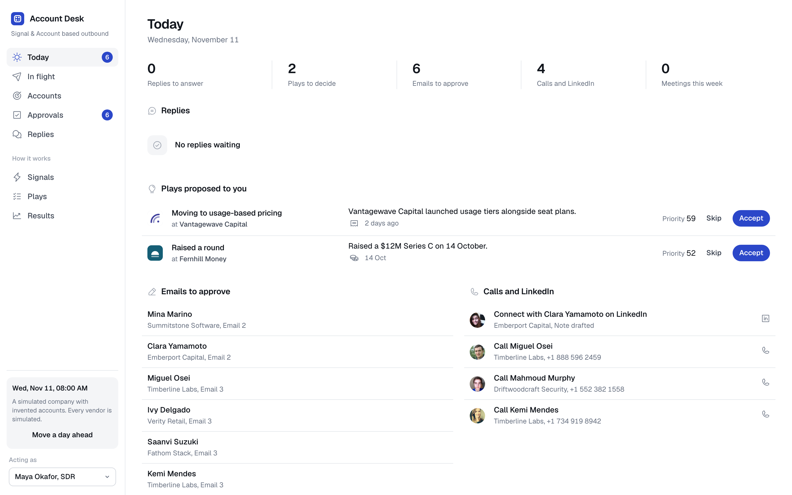
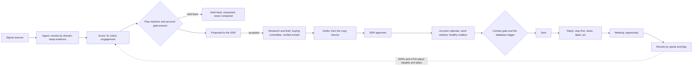

<div align="center">


# Account Desk

**Signal-based, account-based outbound for a small B2B sales team, with a person on every send until a play earns more.**

[](https://github.com/bryanacevedo/account-desk/actions/workflows/ci.yml)


[](LICENSE.md)

[Live demo](https://account-desk-x4ko.onrender.com) · [Film (2:01)](https://bryanacevedo.github.io/project-videos/video/account-desk.mp4) · [Docs](docs/SPEC.md) · [Decisions](docs/DECISIONS.md)

<sub>The public demo is shared by every visitor. Admin actions (kill switch, users, erasure, publishing the ideal customer profile, CSV imports) are blocked there, and "Move a day ahead" moves at most 24 hours at a time.</sub>



</div>

> [!NOTE]
> **What is real and what is simulated.** The desk's own code is real and tested: scoring, plays, the contact gate and the database trigger behind every send, the copy checks, send windows, reply handling, the statistics, the monitors. Every vendor in the demo is simulated, and so is every buyer. The demo and the tests use a deterministic stand-in for the model; live Claude answers the evals, and a desk run with `ANTHROPIC_LIVE` set. The DNS check is live. The Google Postmaster Tools adapter is real code but has never called Google and needs the operator's credentials. The warm-up vendor is a simulated slot. No mail provider is connected, so a live desk cannot send email yet.

<div align="center">

[How it works](#how-it-works) · [Autonomy](#autonomy-is-earned-per-play) · [What it does](#what-it-does) · [The demo in figures](#the-demo-in-figures) · [The AI, measured](#the-ai-measured) · [Compliance](#compliance) · [Run it](#run-it) · [Settings](#settings-and-environment) · [Deploy](#deploy) · [Not yet proven](#not-yet-proven) · [Portfolio](#portfolio)

</div>

Account Desk watches for the moments a company that fits your customer profile shows it may need you (a new finance leader, a pricing change, hiring for the team you serve, a past champion joining), decides which accounts are worth working this week and why, finds the people who buy there, drafts outreach grounded in what happened at that company, has an SDR approve it, sends it from healthy inboxes at a human pace, and handles every reply through to a meeting and pipeline. It measures which signals turn into meetings against accounts that were matched but deliberately held back and never contacted.

It is built for a team that would rather write to 40 companies at the right moment than to 4,000 at random.

[](https://bryanacevedo.github.io/project-videos/video/account-desk.mp4)

**[Watch the walkthrough (2:01)](https://bryanacevedo.github.io/project-videos/video/account-desk.mp4)**: one account, Ridgeway Software, from a new VP Finance on 13 October to two deals, then the held-back test that says it is too early to tell. It was filmed on the demo as it stood on 11 November 2026, and every figure in it was read from that database. The demo is rebuilt from its simulation on each deploy, so the live accounts have moved on since.

In the [live demo](https://account-desk-x4ko.onrender.com), pick who you are acting as in the sidebar (an SDR, the sales manager, or GTM engineering). The company, its accounts, people and vendors are invented. If it has been idle, Render takes up to a minute to wake it.

## How it works

Autonomous "AI SDRs" mostly failed in 2025 and 2026: shallow or invented personalization, burned sending domains, bad data underneath. The teams getting results use signals plus fit to choose accounts, let AI research and draft, and keep a person on the send decision. Account Desk takes that as its design:

| People | AI | Code |
|---|---|---|
| Decide the ideal customer, the plays, which accounts to work | Reads the facts about a company and writes a brief, citing each fact | Scores accounts, matches plays, picks the held-back accounts |
| Approve, edit or write first emails | Drafts each email as sentences, each claim tied to a fact id | Checks every citation, number and name against the facts |
| Answer every positive reply, book meetings, make the calls | Labels a reply from a fixed list and pulls out dates and referrals | Stops the sequence the moment a reply lands, before anyone reads it |
| Change weights and plays when results say so | Pulls objections and competitors out of call notes | Counts which signals and plays produce meetings, against the held-back accounts |

Two more rules came from running outbound in production:

- **Act on tracking data, never cite it.** Website visits, research intent and product sign-ups can trigger a play, but the drafter never sees them and the copy check fails any email that cites one.
- **Make the bad state impossible, and watch for what cannot be.** A send to a suppressed address, a held-back account, or a message edited after approval is refused by a Postgres trigger, so no bug in the app can do it. Promises about time (sent inside the recipient's hours, positive replies answered on time, every source ran) are monitors that alert.



Python 3.13, FastAPI and Postgres 18 with plain SQL in numbered migrations (0001 to 0029). A job queue in Postgres claimed with `FOR UPDATE SKIP LOCKED`. React and Vite for the web app, served by the API. Model calls go through one function with structured outputs, record and replay, and a deterministic stand-in for the demo. The full behaviour is in [docs/SPEC.md](docs/SPEC.md) (section 22 holds every review decision and wins where they differ); decisions are in [docs/DECISIONS.md](docs/DECISIONS.md).

## Autonomy is earned per play

Each play sits at one of four stages, named the same way everywhere in the app:

| Stage | Who sends |
|---|---|
| Research | SDR writes everything |
| Draft | SDR approves every email |
| Supervised | SDR approves first emails and checks a sample of the rest |
| Autonomous | Desk sends to tier B, SDR approves tier A |

Leaving research needs no complaint and known complaint data for every sending domain with an active mailbox, then the manager's decision. Each later step up needs 50 approvals with 90% unedited, no complaint, bounces under 2%, a positive reply rate at the play's floor, and known complaint data for every sending domain with an active mailbox (data older than 7 days counts as unknown), and a manager approves it. For a play at the supervised or autonomous stage, a spam complaint, hard bounces over 3% of its last 200 sends (once it has at least 50), or SDRs editing more than 6 of its last 20 drafts moves it back down a stage on its own.

## What it does

- **Signals.** Seventeen signal types, each with a written reason it matters, a weight and a half-life. Sources are adapters (job postings, funding, job changes, website visits, intent, reviews, technology changes, social engagement, product sign-ups, the CRM, a signed webhook). Every source run is recorded, so a silent source shows up.
- **Scoring.** Fit from a versioned ideal customer profile, intent from decayed signals with a bonus when different kinds of signal agree, engagement from replies and meetings. Every stored score keeps its inputs and must reproduce from them.
- **Plays.** Six shipped plays, each a hypothesis with a trigger, the people to reach, a sequence and an angle. A deterministic share of matched accounts is held back: measured, never contacted.
- **Enrichment and the buying committee.** Up to three people per account by role (finance leader, controller, revenue operations, data). Work emails come from finders asked in order (Findymail, then Prospeo, then LeadMagic in the demo), each paid only for an address it returns; every address is verified, and catch-all addresses go to a second resolver and are never sent to unconfirmed. Company data is read monthly, and a change between two reads is a signal. Every enriched field records which vendor said it, when and how sure it was; a paid answer is kept, so a retried job never pays twice. Gaps are named ("Email in Germany needs consent first").
- **Drafting and the copy checks.** Code checks every draft: citations exist, numbers and proper names appear in a cited fact, it opens with the person's first name, length fits the step, no banned phrases, no long dashes, no links in a first email, not a near copy of a colleague's email, no private signal. A failed draft is rewritten once, then goes to the SDR.
- **Sending.** An account calendar staggers colleagues two business days apart. Sends land inside the recipient's own working hours, skip public holidays, ramp each mailbox, cap each domain, and pause a mailbox at a 2% bounce rate or any complaint. Each sending domain's spam rate and compliance verdict come from Google Postmaster Tools; 0.1% raises a warning, and 0.3% or a verdict of needs work pauses the domain's mailboxes. Weekly inbox tests hold or pause a mailbox that lands in spam. A warm-up vendor, when one is connected, reports each mailbox's warm-up status; the desk's own ramp still sets the limits.
- **Replies.** Stop first. Then clean the reply (quoted history, signatures, legal footers, so an "unsubscribe" in a footer opts nobody out), label it with rules first and the model second, and act: positive replies go to the owner with a deadline and a suggested answer, out-of-office pauses until the return date, referrals become tasks, not-now becomes a hold until the date given. Opt-outs work in five languages and cover every channel.
- **Meetings and pipeline.** Meetings stop the account's sequences. Opportunities are attributed as sourced or influenced. Call notes, once a person marks them worth learning from, become quotes grouped by play and signal.
- **Plays suggested from calls.** Each learning is filed under a theme. When code finds a clear pattern (the same reason to buy or competitor at 5 or more accounts that came in on one signal, from 2 or more SDRs, more often than elsewhere by a Fisher exact test corrected for every pair compared), the desk drafts a play built on it for GTM to turn into a draft play or a manager to set aside ([docs/PLAY-SUGGESTIONS.md](docs/PLAY-SUGGESTIONS.md)).
- **Results.** A funnel from signal to meeting, meeting rate per signal type, and the difference from the held-back accounts with a Newcombe interval. Below the sample size needed to tell a difference, the page says how many accounts are still needed instead of showing a number.
- **Costs.** The Vendors and costs page lists every vendor and source, paid or free, with metered spend, flat monthly fees prorated by the day, the month's projection, spend by play and cost per outbound meeting. The demo's prices are assumptions, marked as such. Google Postmaster Tools is listed as free; the Warm-up slot names Mailivery at its public price of $29 a month (an assumption here, and simulated). AI charges are written on their own connection, since Anthropic bills a call even when the job that made it rolls back, so the ledger can show slightly more charges than the model call log (decision 12).
- **Health.** Monitors, background jobs, the CRM outbox, alerts and spend against each vendor's monthly cap, plus one button that stops all sending.
- **Ask it from an assistant.** `python -m outbound mcp` is a read-only MCP server on stdio with five tools (find accounts, why an account is hot, what is waiting on someone, how a play did, the results summary). Every query runs in a read-only transaction and none returns money.

## The demo in figures

Read on 2026-11-12 from a fresh `python -m outbound demo 90` build of the current code (database `outbound_release`):

| Figure | Value | Population or source |
|---|---|---|
| Accounts | 3,000 | `accounts` |
| SDRs | 6, plus a sales manager and GTM engineering | active `users` |
| People at the start | 24,667 | the simulated world when the build began |
| People on the desk after 90 days | 14,429 | `people`: everyone the desk has found, imported or been told about |
| People still hidden in the simulation | 11,092 | `sim_hidden_people`: people the desk has not found yet, including new hires added by seat changes during the run; the desk never reads this table |
| Days simulated | 90 (13 August to 11 November 2026) | |
| Plays | 7: the six shipped plays (live; one at supervised, one at research, four at draft when the build ended) and one draft play GTM made from a suggestion | `plays` |
| Suggested plays | Every state: three or more open (one back after a "not now"), one made a draft play (shown only as that play), two set aside for now, one dismissed, one or two lapsed | `play_suggestions` |
| Accounts proposed to SDRs | 894 (126 to 190 per SDR); 785 accepted, 15 expired unseen | `account_plays`, treated |
| Accounts held back | 237 | `account_plays`, held back |
| Emails sent | 1,636 | `messages` |
| Positive replies | 103 | `replies` |
| Meetings | 201: 74 booked by SDRs, 127 inbound from the simulated CRM; 162 held, 36 no-shows, 3 still to come | `meetings` |
| Deals sourced by outbound | 36 worth $4,147,000 in all: 6 won ($673,000), 4 lost ($354,000), 26 open ($3,120,000) | `opportunities` |
| Deals influenced by outbound | 10 worth $1,159,000 | `opportunities` |
| Build | 514 seconds on an Apple silicon laptop; a 125 MB database | `python -m outbound demo 90` |

Planted so the demo shows every scenario the app can show. `python -m outbound coverage` counts them: of 99 scenarios a fresh build on 2026-11-12 showed 97 and missed none it must show; the 2 it did not show rest on chance. Every state a play suggestion can reach is required (open, three or more of them, a reason to buy and a competitor among them, one on a signal a live play starts on, drafted, set aside and still set aside, back after a "not now", dismissed, lapsed). Twelve scenarios rest on a handful of events in a 90-day build (a play earning its fourth stage, an opt-out in one language) and are marked `BY_CHANCE` in `src/outbound/coverage.py`.

How the simulation behaves:

- The simulated world gives each company a hidden need; signals and replies are drawn from it, with some signal types linked to need strongly and some barely, so the results pages have something true to find. The simulated CRM opens and closes deals outbound had nothing to do with, so the held-back comparison measures what outbound adds.
- The world holds together the way a real list does: a company's name and product fit its industry, it has one finance leader, and a new finance leader the news announces holds that title and starts that day, while the one they replaced leaves.
- Simulated SDRs edited 275 of the 1,814 emails they approved in this build (15%); they approved 330 LinkedIn notes as written. On Monday mornings the simulated manager approves the next stage for any play at the draft stage or above whose checks all pass; leaving the research stage stays the manager's own call. Demotions are the desk's own.
- Call notes carry planted patterns, each a reason (or a competitor) heard on most first calls of accounts that came in on one signal, some only for a few weeks, and one that later spreads to every call so its pattern lapses (`PLANTED` and `MORE_PLANTED` in `src/outbound/sim/runner.py`). The rule still decides on its own whether each is a pattern. On Tuesdays the simulated GTM engineer turns the hiring one into a draft play, and the manager sets two aside for now and says no to one (`suggestion_routine`); every other suggestion, and one that comes back after a "not now", waits for a person.
- Region rules: the demo's seller does not sell in Singapore, and Australia has no rule, so nobody there is cold-emailed. Every sending domain reports no Postmaster data until it is 45 days old (decision 60).

## The AI, measured

Every task the model does has an eval: 315 cases in all, 241 of them written by a separate agent that never saw the code. Each runs through the desk's real path, is graded by code where code can see the answer, and by a Claude Sonnet 5.5 judge with a written checklist where it cannot (the model under test never grades itself). Answers are from Claude Opus 5.5. Replies, suggested replies, call notes and themes were run live on 2026-11-11; drafting, briefs and suggested plays were re-recorded live on 2026-11-12, and no case is held out of the floors.

| Task | Cases | Result |
|---|---|---|
| Labelling replies | 148 | 99% labelled as a careful person would (147), 95% exact; every stop request caught (13 of 13); every positive reply kept positive (53 of 53); no invented referral email; return dates 5 of 6 |
| Drafting emails and LinkedIn notes | 50 | 88% pass the copy checks and the claim checker after one rewrite (44 of 50; 31 first time); the rest are held as Needs a rewrite, never sent on their own; none cites a private signal or a fact that does not exist; every instruction hidden in a fact ignored; the judge finds 84% (42 of 50) say nothing about the buyer the facts do not support; 1 mentions something its case forbids |
| Account briefs | 20 | 16 of 20 with no number or name the code finds unfaithful; 20 of 20 faithful to their facts by the judge; every instruction hidden in a fact ignored |
| Suggested replies | 30 | 63% pass every check (19 of 30; tone is the usual miss); no invented number or placeholder; 1 in 30 judged to invent something |
| Learnings from call notes | 20 | 87% of expected learnings found (40 of 46); every quote verbatim; 95% invent nothing |
| Filing learnings under themes | 32 | 89% of pairs grouped as a person would; different ideas never merged, but the same idea is often split (58% of pairs that belong together kept together) |
| Drafting a play from a pattern | 15 | 11 of 15 pass every check; every trigger and persona from the catalog and no forbidden name in all 15 (checked in code); 14 of 15 never state the theme as the buyer's situation; 12 of 15 built on the theme and adding no claim it does not support (judge) |

Known gap: suggested plays keep their personas within what the case allows in only 3 of 15 (`evals/DRAFT_PLAY.md`). The floors check that every persona comes from the catalog, not that it fits the pattern, so a manager or GTM still has to read the people a suggested play targets.

The desk does not rely on the prompts alone. A suggested reply that states a number, product fact or placeholder the prospect did not bring up is rewritten once and then withheld. Every sentence of a draft about the buyer is read against its facts by a second call; a draft that still fails is held as Needs a rewrite, which no autonomous play can send.

`make evals` replays the recorded answers, free; the test suite replays them too and fails when a recording no longer matches the current prompt. `make evals-live` calls Claude and the judge again (roughly $5 to $10). Each score has a floor in `evals/thresholds.json`; the safety ones (stop requests, private signals, hidden instructions, invented emails) must stay at 100%. A weekly workflow runs the live evals once an `ANTHROPIC_API_KEY` secret is added to the repository; this one has none, so it never runs here. Reports with every case in full: `evals/REPLIES.md`, `WRITING.md`, `SUGGEST.md`, `EXTRACT.md`, `THEMES.md`, `DRAFT_PLAY.md`.

## Compliance

Every rule here fails closed: a value nobody has set blocks contact. These are a starting point, not legal advice. Counsel to confirm.

- **Region rules** key on the person's country: allowed, a recorded legitimate interest (`basis_required`), consent (`consent_required`), or blocked. Spain and the Netherlands need consent, businesses included. A country with no rule, or a person whose country is unknown, gets no cold email; the database refuses it too.
- **UK subscriber type.** A UK sole trader or partnership is an individual subscriber under PECR and needs consent; accounts whose type is not known count as individual. A send trigger enforces it as well as the contact gate.
- **Legitimate-interest assessment.** A play that relies on legitimate interest cannot launch without the assessment's reference and its review date (`lia_review_due`), or once that date has passed.
- **Calls** follow a per-country call rule that names the do-not-call register screened first, and happen only inside the call window in the person's own time, on weekdays that are not public holidays. Germany and the Netherlands are not called by default.
- **Retention.** A daily job deletes prospects with no reply and no activity for `retention_months`; their opt-outs stay as hashes so they are never contacted or added again. Erasure on request deletes the person and everything that quotes them.
- **Every email** carries the sender's postal address, a plain opt-out and RFC 8058 one-click unsubscribe headers; recipients in the EU, EEA, UK, Switzerland and Brazil also get a privacy notice link that says where the data came from.
- **LinkedIn through HeyReach.** LinkedIn's User Agreement does not allow automating an account with a tool such as HeyReach; using one breaks LinkedIn's terms and is the operator's own risk, including the loss of the SDRs' LinkedIn accounts.

Decisions 51 to 55 record each rule and its source.

## Run it

You need Python 3.13 with [uv](https://docs.astral.sh/uv/), Node 26 and Postgres 18 installed (the scripts start a private Postgres in `.data/`).

```bash
make setup
```

```bash
make demo
```

That builds the invented company and simulates 90 days of signals, SDRs, buyers and vendors, then serves the desk at http://localhost:8800. Pick who you are acting as in the sidebar; "Move a day ahead" runs the world forward a day. `make coverage` counts every scenario the demo shows. To build into another database, set `DATABASE_URL` first.

```bash
make test
```

The tests run on real Postgres, including a 21-day simulation of the whole desk followed by every promise checked against what happened (nobody held back was contacted, nothing was sent after a reply, every sent email matches what was approved and carries its legal footer, no email cites tracking data) and one full 90-day demo build. On 2026-11-12: 325 passed, and 2 skipped, the CRM Desk half of the contract tests, which needs a running CRM Desk.

### A real desk, not the demo

```bash
python -m outbound init examples/desk.example.json
```

```bash
python -m outbound import accounts examples/accounts.example.csv
```

```bash
python -m outbound import people examples/people.example.csv
```

`init` creates the team, sending domains and mailboxes from one file, on an empty database only. Plays start as drafts with your own legitimate-interest reference and review date, for a manager to read and launch. Domains send nothing until the daily DNS check has read their SPF, DKIM and DMARC. Imports report every row they refuse and why.

### LinkedIn through HeyReach

Set `LINKEDIN_TOOL_TOKEN` to a long random string, then in HeyReach add a webhook to `https://<your desk>/api/webhooks/linkedin/<token>` for "Connection request accepted" and "Message reply received". The desk finds the person by their LinkedIn profile; events for people it does not know are acknowledged and noted. HeyReach reports only the first reply in a conversation, so later messages are pasted on the person's page. Read the terms note under [Compliance](#compliance) first.

### Choosing the CRM

`CRM` picks the desk's CRM. Unset, nothing changes: the demo keeps its simulated CRM, and live mode keeps a CRM that refuses. `CRM=crmdesk` makes [CRM Desk](https://crm-desk-sevh.onrender.com) the CRM through `src/outbound/adapters/crmdesk.py`: the CRM outbox writes emails, SDR steps, meetings, tasks and opt-outs there, and the desk reads deals and account owners from its change feeds. It needs `CRM_DESK_URL` and `CRM_DESK_KEY`. Every call fails closed: a timeout, a refused connection, a 429 or a 5xx leaves the outbox row queued to try again, up to five tries, after which it is marked dead and raises an alert. `CRM=salesforce` is refused with an error, because there is no Salesforce adapter yet, and so is any value the desk does not know (`default` means the same as unset). The contract tests (`tests/test_crm_contract.py`) run on both CRMs where they apply; the CRM Desk half needs a running CRM Desk named by `CRM_DESK_URL`, `CRM_DESK_KEY` and `CRM_DESK_ADMIN_KEY`, and is skipped without them. The public CRM Desk demo refuses API keys, so it needs your own install.

### At production size

Measured on 2026-11-11 on a laptop (Apple silicon, Postgres 18): 5,000 accounts simulated for 30 days in 71 seconds with no failed job, then 2 million signals loaded on top. Every page answered in under 50 ms except Signals (under 0.2 s); rescoring took 10 ms an account and 0.8 s per nightly batch of 500; every monitor ran in 50 ms or less. At that size the monitors found the real limit: four SDRs cannot approve first emails fast enough for 5,000 accounts, so 38 accepted accounts passed their play's time limit before a first email. The fix is people or autonomy, not code.

## Settings and environment

| Variable | What it does |
|---|---|
| `DATABASE_URL` | Postgres to use (default `postgres://postgres@127.0.0.1:54329/outbound`) |
| `MODE` | `demo` (default) or `live`. Live refuses to start without `AUTH_MODE=header`, `WEBHOOK_SECRET`, and the operator's own `SENDER_COMPANY`, `SENDER_ADDRESS` and `PRIVACY_URL` (blank or the demo seller's values are refused) |
| `AUTH_MODE` | `demo` (pick who you act as) or `header` (a verified Cloudflare Access token; needs `CF_ACCESS_TEAM_DOMAIN` and `CF_ACCESS_AUD`) |
| `LIVE_SEND` | Needs `MODE=live` and `AUTH_MODE=header`; never allowed with `PUBLIC_DEMO` |
| `PUBLIC_DEMO` | A shared public demo: admin writes blocked, moves of at most 24 hours |
| `FORWARDED_ALLOW_IPS` | Proxies whose `X-Forwarded-For` is believed, comma separated (default `127.0.0.1`; `render.yaml` sets `10.0.0.0/8`). Rate limits key on the nearest forwarded hop that is not one of them |
| `POSTMASTER_CLIENT_ID`, `POSTMASTER_CLIENT_SECRET`, `POSTMASTER_REFRESH_TOKEN` | Google Postmaster Tools; any unset means no Postmaster data, said so |
| `LINKEDIN_TOOL_TOKEN` | Turns on the HeyReach webhook |
| `ANTHROPIC_LIVE` | Live Claude instead of the stand-in |
| `CRM` | Which CRM the desk uses. Unset keeps today's: the simulated CRM in demo mode, and in live mode one that refuses. `crmdesk` uses CRM Desk; `salesforce` is refused, since no Salesforce adapter exists yet (decision 61) |
| `CRM_DESK_URL`, `CRM_DESK_KEY` | Needed with `CRM=crmdesk`: the CRM Desk install and a key made there with `--desk account_desk` |

Desk settings (rows in the `settings` table, seeded from `src/outbound/seed/catalog.py`): `retention_months` (12), `call_window` (09:00 to 18:00, weekdays, in the person's own time). Each play also carries `lia_ref` and `lia_review_due`, its legitimate-interest assessment and when it is next reviewed.

## Deploy

`render.yaml` describes the hosted demo: one Docker service on Render's free plan with Postgres inside the container and the 90-day simulation built into the image (`scripts/docker-build-demo.sh`), so a start or a wake from sleep only boots Postgres. `make docker` builds and runs the same image locally (it uses the Postgres that Debian ships, not a pinned 18). On Render's own builder the image took about 17 minutes to build (2026-11-12).

## Not yet proven

- Every AI task is measured on real Claude answers; the demo and tests use a deterministic stand-in. The eval cases are written to be realistic, but none is a real buyer's reply.
- Only the DNS check has a live adapter that has run against the real service. The Postmaster Tools adapter has never called Google: its endpoints and field names come from the v2 reference, and Postmaster returns nothing until a domain is verified there and sends enough mail to Gmail. The warm-up vendor has no live adapter. There is no mail provider adapter, so a live desk cannot send email; the other vendor contracts are in `src/outbound/adapters/__init__.py`. Yahoo's feedback loop and Microsoft SNDS are not built.
- The CRM Desk adapter has run only against a CRM Desk holding invented data, and there is no Salesforce adapter, so a team on Salesforce cannot connect its CRM yet.
- The HeyReach webhook has not seen a real HeyReach event; the accepted event's field names come from third-party guides.
- Cloudflare Access sign-in has not been run against a real Access app, and contention was measured with one server process. Rate limits are held in memory, for one instance.
- Prices on the cost page are demo assumptions until a manager enters real ones.
- Profile photos in the demo are stock portraits from randomuser.me. In live use the photo URL comes from the enrichment vendor and is erased with the person.

## Words used here

- **Signal**: a dated fact about a company that may mean it needs you. It always keeps its evidence.
- **Play**: one hypothesis about outreach: a trigger, the people to reach, a sequence of steps and an angle.
- **Proposed**: a play matched an account and the desk put it to an SDR, who accepts or skips it.
- **Positive reply**: interested, asking for a meeting, or asking a question.
- **SDR**: sales development rep, the person who approves, edits or writes first outreach and answers replies.
- **GTM engineering**: go-to-market engineering, the role that sets up and tunes the desk.
- **Fit tier**: A, B or C from how well an account matches the ideal customer profile; X means excluded.
- **A play's floor**: the positive reply rate a play must keep to earn more autonomy.
- **Held back**: accounts a play matched but deliberately never contacts, so results can be compared against them (the holdout in the code and the spec).
- **Inbox test**: a test send to seed mailboxes at Gmail and Outlook that shows whether mail lands in the inbox or in spam.
- **Account gate**: the code check that decides whether a matched account may be proposed (kill switch, the account's and its parent's lifecycle, tier X, the do-not-contact list, holds, a play already running).
- **Contact gate**: the code check before any touch to a person (do-not-contact list, holds, a working and recently verified email, another sequence, the cooldown, an unanswered reply at the account, the country rule, consent or a recorded basis); a database trigger repeats the hard rules at send time.
- **Account calendar**: the schedule that keeps colleagues at one account at least two business days apart.
- **Learning**: one reason to buy, objection or competitor taken from a call note, with its verbatim quote.
- **Theme**: a group of learnings that say the same thing in different words.
- **Eval floor**: the lowest score an eval may return before the test suite fails (`evals/thresholds.json`).
- **Catch-all**: a mail server that accepts every address, so a normal check cannot say whether one is real.

## Portfolio

| Project | What it does | Links |
|---|---|---|
| Account Desk (this repository) | Signal-based, account-based outbound with a person on the send decision | [Live demo](https://account-desk-x4ko.onrender.com) · [Film](https://bryanacevedo.github.io/project-videos/video/account-desk.mp4) |
| Events Desk | For someone who runs events all year: seat requests and approvals, attendee lists turned into the companies and people worth meeting, with checked emails, handed back as a sheet for sales | [Code](https://github.com/bryanacevedo/events-desk) · [Live demo](https://events-desk.onrender.com) · [Film](https://bryanacevedo.github.io/project-videos/video/events-desk.mp4) |
| Market Desk | Decides who a B2B team sells to from its own deals, sizes that market and splits it into territories | [Code](https://github.com/bryanacevedo/market-desk) · [Live demo](https://market-desk-3kou.onrender.com) · [Film](https://bryanacevedo.github.io/project-videos/video/market-desk.mp4) |
| CRM Desk | A CRM for teams of one to fifty with Salesforce's data model and a simpler experience; Account Desk and Events Desk can use it as their CRM | [Live demo](https://crm-desk-sevh.onrender.com) · [Film](https://bryanacevedo.github.io/project-videos/video/crm-desk.mp4) (code private) |

All four films: https://bryanacevedo.github.io/project-videos/

## License

PolyForm Noncommercial 1.0.0.
