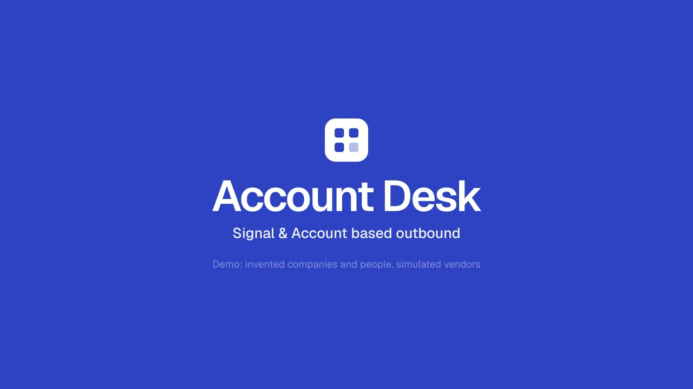
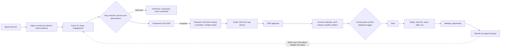

# Account Desk

Signal & Account based outbound.

[](https://github.com/bryanacevedo/account-desk/actions/workflows/ci.yml)

Account Desk runs signal-based, account-based outbound for a B2B sales team. It watches for the moments a company that fits your customer profile shows it may need you (a new finance leader, a pricing change, hiring for the team you serve, a past champion joining), decides which accounts are worth working this week and why, finds the people who buy there, drafts outreach grounded in what actually happened at that company, has an SDR approve it (until a play has earned more autonomy), sends it from healthy inboxes at a human pace, and handles every reply through to a meeting and pipeline. It measures which signals turn into meetings against accounts that were matched but deliberately held back and never contacted.

It is built for a small team that would rather write to 40 companies at the right moment than to 4,000 at random.

[](https://bryanacevedo.github.io/project-videos/video/account-desk.mp4)

**[Watch the walkthrough (2:01)](https://bryanacevedo.github.io/project-videos/video/account-desk.mp4)**: one account, Ridgeway Software, from a new VP Finance on 13 October to two deals, then the held-back test that says it is too early to tell. It was filmed on the demo as it stood on 11 November 2026, and every figure in it was read from that database. The demo is rebuilt from its simulation on each deploy, so the live accounts have moved on since.

**[Try the live demo](https://account-desk-x4ko.onrender.com).** Pick who you are acting as in the sidebar (an SDR, the sales manager, or GTM engineering). The company, its accounts, people and vendors are all invented, and every vendor is simulated. If it has been idle, Render takes up to a minute to wake it; after that pages answer in under a second. Read "What is real and what is simulated" before trusting any number in it.

## The rules it is built on

Autonomous "AI SDRs" mostly failed in 2025 and 2026: shallow or invented personalization, burned sending domains, bad data underneath. The teams getting results use signals plus fit to choose accounts, let AI research and draft, and keep a person on the send decision. Account Desk takes that as its design:

| People | AI | Code |
|---|---|---|
| Decide the ideal customer, the plays, which accounts to work | Reads the facts about a company and writes a brief, citing each fact | Scores accounts, matches plays, picks the held-back accounts |
| Approve, edit or write first emails (every one, until a play earns autonomy) | Drafts each email as sentences, each claim tied to a fact id | Checks every citation, every number and every name against the facts |
| Answer every positive reply, book meetings, make the calls | Labels a reply from a fixed list and pulls out dates and referrals | Stops the sequence the moment a reply lands, before anyone reads it |
| Change weights and plays when results say so | Pulls objections and competitors out of call notes | Counts which signals and plays produce meetings, against the held-back accounts |

Three more rules came from running outbound in production:

- **Act on tracking data, never cite it.** Website visits, research intent and product sign-ups can trigger a play, but the drafter never sees them and the copy check fails any email that cites one. Buyers read that as surveillance.
- **Make the bad state impossible, and watch for what cannot be.** A send to a suppressed address, a held-back account or a message edited after approval is refused by a Postgres trigger, so no bug in the app can do it. Promises about time (sent inside the recipient's hours, hot replies answered on time, every source ran) are monitors that alert.
- **Autonomy is earned per play.** Four stages: the SDR writes; the desk drafts and the SDR approves every message; the SDR approves every first email and a sample of the rest; and, last, the desk sends emails to fit tier B accounts that passed every check on its own, while tier A still goes to a person. Each step up needs 50 approvals with 90% unedited, no complaint, bounces under 2%, a positive reply rate at the play's floor, and known complaint data for every sending domain, and a manager approves it. A spam complaint, hard bounces over 3% of the play's last 200 sends, or SDRs editing more than 6 of the last 20 drafts moves a play back down a stage on its own.

## What it does

- **Enrichment.** People search finds the buying group; work emails come from finders asked in order (Findymail, then Prospeo, then LeadMagic in the demo), each paid only for an address it returns; every address is verified, and addresses on catch-all servers, which accept anything, go to a second resolver and are never sent to unconfirmed. Company data (industry, size, tools, funding, open roles, headcount by team) is read monthly for working accounts, and a change between two reads is a signal: a finance team growing, a role opening, a tool arriving or leaving, a new round, someone new in a finance seat. Phones are typed and do-not-call numbers are never dialled. Every enriched field records which vendor said it, when and how sure it was; one person per LinkedIn profile however the link is written; a paid answer is kept, so a retried job never pays twice; people in open plays are re-read quarterly and addresses re-verified after 45 days.
- **Costs.** The Vendors and costs page lists every vendor and source, paid or free, connected or not, with metered spend, flat monthly fees prorated by the day, the month's projection, last month, spend by play and cost per outbound meeting. The demo's prices are assumptions, marked as such.
- **Signals.** Seventeen signal types, each with a written reason it matters, a weight and a half-life. Sources are adapters (job postings, funding, job changes, website visits, intent, reviews, technology changes, social engagement, product sign-ups, the CRM, a signed webhook). Every source run is recorded, so a silent source shows up.
- **Scoring.** Fit from a versioned ideal customer profile, intent from decayed signals with a bonus when different kinds of signal agree, engagement from replies and meetings. Every stored score keeps its inputs and must reproduce from them.
- **Plays.** Six shipped plays, each a hypothesis with a trigger, the people to reach, a sequence and an angle. A deterministic share of matched accounts is held back: measured, never contacted.
- **The buying committee.** Up to three people per account by role (finance leader, controller, revenue operations, data), found through a people search, emails found and verified, phones found for call steps, all charged to a ledger in each vendor's own unit. Gaps are named ("Email in Germany needs consent first").
- **Drafting and the copy checks.** Code checks every draft: citations exist, numbers and proper names appear in a cited fact, it opens with the person's first name, length fits the step, no banned phrases, no long dashes, no links in a first email, not a near copy of a colleague's email, no private signal. A failed draft is rewritten once, then goes to the SDR.
- **Sending.** An account calendar staggers colleagues two business days apart. Sends land inside the recipient's own working hours, skip public holidays, ramp each mailbox, cap each domain, and pause a mailbox at a 2% bounce rate or any complaint. Every email carries the sender's postal address, a plain opt-out and RFC 8058 one-click unsubscribe headers; EU and UK recipients also get a privacy notice link.
- **Replies.** Stop first. Then clean the reply (quoted history, signatures, legal footers, so an "unsubscribe" in a footer opts nobody out), label it with rules first and the model second, and act: hot replies go to the owner with a deadline and a suggested answer, out-of-office pauses until the return date, referrals become tasks, not-now becomes a hold until the date given. Opt-outs work in five languages.
- **Meetings and pipeline.** Meetings stop the account's sequences. Opportunities are attributed as sourced or influenced. Call notes, once a person marks them worth learning from, become quotes grouped by play and signal.
- **Plays suggested from calls.** Each learning is filed under a theme, one label for one idea however it was worded. When code finds a clear pattern (the same reason to buy or competitor at 5 or more accounts that came in on one signal, from 2 or more SDRs, clearly more often than elsewhere by a Fisher exact test corrected for every pair compared), the desk drafts a play built on it. Managers and GTM read the numbers and every quote behind it on Plays; GTM turns it into a draft play in the play editor, and either can set it aside or dismiss the theme for good.
- **Results.** A funnel from signal to meeting, meeting rate per signal type, and the difference from the held-back accounts with a Newcombe interval. Below the sample size needed to tell a difference, the page says how many accounts are still needed instead of showing a number.
- **Health.** Monitors, background jobs, the CRM outbox, alerts and spend against each vendor's monthly cap, plus one button that stops all sending.

## How it fits together



Python 3.13, FastAPI and Postgres 18 with plain SQL in numbered migrations. A job queue in Postgres claimed with `FOR UPDATE SKIP LOCKED`. React and Vite for the web app, served by the API. Model calls go through one function with structured outputs, record and replay, and a deterministic stand-in for the demo.

The full behaviour is in [docs/SPEC.md](docs/SPEC.md), reviewed in three passes before any code (against its sources, against how strong teams run outbound today, and again once the blockers were fixed; every finding resolved in section 22). Decisions are in [docs/DECISIONS.md](docs/DECISIONS.md).

## Run it

You need Python 3.13 with [uv](https://docs.astral.sh/uv/), Node 26 and Postgres 18 installed (the scripts start a private Postgres in `.data/`).

```bash
make setup
```

```bash
make demo
```

That builds an invented company with 700 accounts, simulates 90 days of signals, SDRs, buyers and vendors (about two minutes), and serves the desk at http://localhost:8800. Pick who you are acting as in the sidebar. "Move a day ahead" runs the world forward a day.

```bash
make test
```

The tests run on real Postgres, including a 21-day simulation of the whole desk followed by every promise checked against what actually happened: nobody held back was contacted, nothing was sent after a reply, every sent email matches what was approved and carries its legal footer, no email cites tracking data.

Or with Docker, the same image the hosted demo runs (it uses the Postgres that Debian ships, not a pinned 18):

```bash
make docker
```

### A real desk, not the demo

```bash
python -m outbound init examples/desk.example.json
```

```bash
python -m outbound import accounts examples/accounts.example.csv
```

```bash
python -m outbound import people examples/people.example.csv
```

`init` creates the team, sending domains and mailboxes from one file, on an empty database only. Plays start as drafts with your own legitimate-interest reference, for a manager to read and launch. Domains send nothing until the daily DNS check has read their SPF, DKIM and DMARC. Imports report every row they refuse and why. GTM and managers can also import from Settings.

### Ask it from an assistant

```bash
python -m outbound mcp
```

A read-only MCP server on stdio with five tools: find accounts, why an account is hot, what is waiting on someone, how a play did, and the results summary. Every query runs in a read-only transaction and none returns money.

### At production size

Measured on 2026-11-11 on a laptop (Apple silicon, Postgres 18): 5,000 accounts simulated for 30 days in 71 seconds with no failed job, then 2 million signals loaded on top. Every page answered in under 50 ms except Signals (under 0.2 s); rescoring took 10 ms an account and 0.8 s per nightly batch of 500; every monitor ran in 50 ms or less. Two pages took 2.4 to 2.7 seconds before an index covering signal type and time, and a feed query that walks the status index instead of sorting every signal.

At that size the monitors also found the real limit: four SDRs cannot approve first emails fast enough for 5,000 accounts, so 38 accepted accounts passed their play's time limit before a first email. The fix is people or autonomy, not code.

### LinkedIn through HeyReach

Set `LINKEDIN_TOOL_TOKEN` to a long random string, then in HeyReach add a webhook to `https://<your desk>/api/webhooks/linkedin/<token>` for "Connection request accepted" and "Message reply received". The desk finds the person by their LinkedIn profile; events for people it does not know are acknowledged and noted. HeyReach reports only the first reply in a conversation, so later messages are pasted on the person's page.

## The AI, measured

Every task the model does has an eval: 315 cases in all, 241 of them written by a separate agent that never saw the
code, so they test what the desk should do rather than what it happens to do. Each runs through the desk's real path,
is graded by code where code can see the answer, and by a Claude Sonnet 5.5 judge with a written checklist where it
cannot (the model under test never grades itself). Live run on 2026-11-11 with Claude Opus 5.5:

| Task | Cases | Result |
|---|---|---|
| Labelling replies | 148 | 99% labelled as a careful person would, 95% exact; every stop request caught; every positive reply kept positive; no invented referral email; return dates 5 of 6 |
| Drafting emails and LinkedIn notes | 50 | 94% pass the copy checks and the claim checker after one rewrite; the rest are held as Needs a rewrite, never sent on their own; none cites a private signal or a fact that does not exist; none follows an instruction hidden in a fact; the judge, stricter than the desk's own checker, finds that 70% say nothing about the buyer that the facts do not support |
| Account briefs | 20 | 100% faithful to their facts by the judge; every instruction hidden in a fact ignored |
| Suggested replies | 30 | 63% pass every check (tone is the usual miss); none has an invented number or placeholder; 1 in 30 repeats a prospect's question about an integration as if it exists |
| Learnings from call notes | 20 | 87% of expected learnings found; every quote verbatim; 95% invent nothing |
| Filing learnings under themes | 32 | 89% of pairs grouped as a person would; different ideas never merged, but the same idea is often split (58% of pairs that belong together kept together); no label names a person or address |
| Drafting a play from a pattern | 15 | every trigger and persona from the catalog and no forbidden name (both checked in code); 10 of 15 pass every check; 14 of 15 never state the theme as the buyer's situation; 11 of 15 add no claim the theme does not support |

The first live run found real problems and the prompts were fixed against the eval: suggested replies invented
integrations and data locations or left placeholders in half the cases (now no placeholders, and 1 in 30 invents something); drafts stated guesses about the
buyer's billing as fact (judge-faithful 40% on the first live run, 70% now); briefs stated inferences as findings (judge-faithful 10% on the first live run, 100% now); return dates missed because the model was never told today's date. Reports with every case in full:
`evals/REPLIES.md`, `WRITING.md`, `SUGGEST.md`, `EXTRACT.md`, `THEMES.md`, `DRAFT_PLAY.md` (the play prompt was tuned once against its first run: 4 of 15 passed every check before, 10 of 15 after); the cases' coverage in `evals/CASES_V2.md`.

```bash
make evals
```

The desk does not rely on the prompts alone. A suggested reply that states a number, product fact or placeholder the
prospect did not bring up is rewritten once and then withheld, so the SDR writes their own. Every sentence of a draft
about the buyer is read against its facts by a second call; an unsupported one goes back for a rewrite, and a draft that
still fails is held as Needs a rewrite, which no autonomous play can send.

`make evals` replays the recorded answers, free. CI does not run `make evals`; it replays the same recordings through
the test suite (`tests/test_evals.py`, part of `uv run pytest`), which also fails when a recording no longer matches
the current prompt. `make evals-live` calls Claude and the judge again (roughly $5 to $10). Each score has a floor in
`evals/thresholds.json`, set a little under the latest result: 0 points under for judge-faithful drafts (70% against a
70% floor), 20 for brief faithfulness (100% against 80%), and 4 to 8 points for most of the rest. The safety ones (stop requests, private signals, hidden
instructions, invented emails) must stay at 100%. A weekly workflow (`.github/workflows/evals.yml`) runs the live evals
and fails below a floor, but only once an `ANTHROPIC_API_KEY` secret is added to the repository; this demo does not
have one, so it never runs here. In the desk itself, a check raises an alert when SDRs start editing many more drafts
than in the weeks before.

## What is real and what is simulated

**Real and tested:** the scoring, plays, the contact gate and the database trigger behind it (including mailbox and domain daily caps, and no email after someone engaged on LinkedIn or by phone), the copy checks for email and LinkedIn, the account calendar, send windows and holidays, mailbox and domain health rules, inbox placement rules, stop-first reply handling, reply cleaning and the rules that label replies, referrals and job changes from replies, attribution (recomputed when a meeting falls through), the statistics, signed webhooks for replies, signals and calendar bookings, one-click unsubscribe, erasure, setup from a file with CSV imports, the read-only MCP server, the job queue and the monitors. The DNS check is live: it reads SPF, DKIM and DMARC over DNS-over-HTTPS.

**Simulated:** every other vendor (people search, email finder and verifier, phone finder, website research, the mail provider, deliverability telemetry and seed tests, blocklists, the CRM, Slack) and every buyer. The simulated CRM opens and closes deals, including deals and demo requests that outbound had nothing to do with, so the held-back comparison measures what outbound adds. The simulated world gives each company a hidden need; signals and replies are drawn from it, with some signal types linked to need strongly and some barely, so the results pages have something true to find. One relationship is planted for play suggestions (`PLANTED` in `src/outbound/sim/runner.py`): on 90% of first calls, accounts that came in on a new finance leader say an audit flagged revenue recognition, those hiring in finance operations say the close team reconciles usage by hand, those changing their pricing model say they are launching usage pricing, and those reviewing a competitor name Meterline. To keep the contrast clear, those four reasons were also made rarer everywhere else (their weight in the general pool went from 2, 2, 2 and 3 to 1). The suggestions come from that plant, found by the same rule a real desk uses. Builds differ run to run, so which pattern opens varies, and a build can open none: one build in six did at 80% of calls, none of eight has since the plant went to 90%.

**Not yet proven:**

- Every AI task is measured on real Claude answers (`evals/`, 315 cases); the demo and tests use a deterministic stand-in. The cases are written to be realistic but none is a real buyer's reply.
- Only DNS checks have a live adapter. There is no mail provider adapter yet, so a live desk cannot send email; the other contracts are in `src/outbound/adapters/__init__.py`.
- The company-data vendor and the catch-all resolver are simulated; no live adapter exists for either yet.
- The HeyReach webhook has not seen a real HeyReach event (if an account sends an event for every reply, the desk takes those too); the accepted event's field names come from third-party guides.
- Cloudflare Access login has not been run against a real Access app, and contention was measured with one server process.
- Prices on the cost page are demo assumptions until a manager enters real ones.
- There is no login. "Acting as" is chosen from a menu in demo mode; `AUTH_MODE=header` reads identity from a verified Cloudflare Access token (no other proxy is supported yet). Live sending refuses to start in demo mode.
- Region rules (which countries need a recorded legitimate interest or consent before a cold email) are a starting point. Counsel to confirm.
- Profile photos in the demo are stock portraits from randomuser.me. In live use the photo URL comes from the enrichment vendor and is erased with the person.

## Words used here

- **Signal**: a dated fact about a company that may mean it needs you, such as a new finance leader or a pricing change. It always keeps its evidence.
- **Play**: one hypothesis about outreach: a trigger, the people to reach, a sequence of steps and an angle.
- **SDR**: sales development rep, the person who approves, edits or writes first outreach and answers replies.
- **GTM engineering**: go-to-market engineering, the role that sets up and tunes the desk (plays, signal weights, imports) rather than working accounts.
- **Autonomy stage**: how much a play may do without a person, from the SDR writing everything to the desk sending tier B emails on its own. A play moves up only on a manager's approval.
- **Fit tier**: A, B or C from how well an account matches the ideal customer profile; X means excluded.
- **A play's floor**: the positive-reply rate a play must keep to earn more autonomy.
- **Account gate, contact gate**: the checks before a play is proposed for an account, and before a person is contacted.
- **Held back**: accounts a play matched but deliberately never contacts, so results can be compared against them. The same thing is called the comparison group in some pages and the holdout in the code and the spec.
- **Catch-all**: a mail server that accepts every address, so a normal check cannot say whether one is real.

## License

PolyForm Noncommercial 1.0.0.
