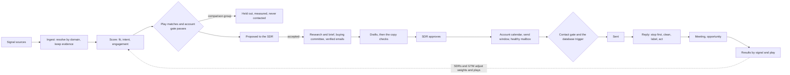

# Outbound Desk

[](https://github.com/bryanacevedo/outbound-desk/actions/workflows/ci.yml)

Outbound Desk runs signal-based, account-based outbound for a B2B sales team. It watches for the moments a company that fits your customer profile shows it may need you (a new finance leader, a pricing change, hiring for the team you serve, a past champion joining), decides which accounts are worth working this week and why, finds the people who buy there, drafts outreach grounded in what actually happened at that company, has an SDR approve it, sends it from healthy inboxes at a human pace, and handles every reply through to a meeting and pipeline. It measures which signals turn into meetings against a comparison group nobody contacted.

It is built for a small team that would rather write to 40 companies at the right moment than to 4,000 at random.

**[Try the live demo](https://outbound-desk.onrender.com).** Pick who you are acting as in the sidebar (an SDR, the sales manager, or GTM engineering). The company, its accounts, people and vendors are all invented, and every vendor is simulated. If it has been idle, the first load takes about a minute. Read "What is real and what is simulated" before trusting any number in it.

## The rules it is built on

Autonomous "AI SDRs" mostly failed in 2025 and 2026: shallow or invented personalization, burned sending domains, bad data underneath. The teams getting results use signals plus fit to choose accounts, let AI research and draft, and keep a person on the send decision. Outbound Desk takes that as its design:

| People | AI | Code |
|---|---|---|
| Decide the ideal customer, the plays, which accounts to work | Reads the facts about a company and writes a brief, citing each fact | Scores accounts, matches plays, draws the comparison group |
| Approve, edit or write every first email | Drafts each email as sentences, each claim tied to a fact id | Checks every citation, every number and every name against the facts |
| Answer every positive reply, book meetings, make the calls | Labels a reply from a fixed list and pulls out dates and referrals | Stops the sequence the moment a reply lands, before anyone reads it |
| Change weights and plays when results say so | Pulls objections and competitors out of call notes | Counts which signals and plays produce meetings, against the comparison group |

Three more rules came from running outbound in production:

- **Act on tracking data, never cite it.** Website visits, research intent and product sign-ups can trigger a play, but the drafter never sees them and the copy check fails any email that cites one. Buyers read that as surveillance.
- **Make the bad state impossible, and watch for what cannot be.** A send to a suppressed address, a holdout account or a message edited after approval is refused by a Postgres trigger, so no bug in the app can do it. Promises about time (sent inside the recipient's hours, hot replies answered on time, every source ran) are monitors that alert.
- **Autonomy is earned per play.** A play moves from "SDR writes" to "desk drafts, SDR approves" to "SDR approves first emails" only after 50 approvals with 90% unedited, no complaint, low bounces, and known complaint data for every sending domain. A manager approves each step.

## What it does

- **Signals.** Seventeen signal types, each with a written reason it matters, a weight and a half-life. Sources are adapters (job postings, funding, job changes, website visits, intent, reviews, technology changes, social engagement, product sign-ups, the CRM, a signed webhook). Every source run is recorded, so a silent source shows up.
- **Scoring.** Fit from a versioned ideal customer profile, intent from decayed signals with a bonus when different kinds of signal agree, engagement from replies and meetings. Every stored score keeps its inputs and must reproduce from them.
- **Plays.** Six shipped plays, each a hypothesis with a trigger, the people to reach, a sequence and an angle. A deterministic share of matched accounts goes to a comparison group that is never contacted.
- **The buying committee.** Up to three people per account by role (finance leader, controller, revenue operations, data), found through a people search, emails found and verified, phones found for call steps, all charged to a ledger in each vendor's own unit. Gaps are named ("Email in Germany needs consent first").
- **Drafting and the copy checks.** Code checks every draft: citations exist, numbers and proper names appear in a cited fact, it opens with the person's first name, length fits the step, no banned phrases, no long dashes, no links in a first email, not a near copy of a colleague's email, no private signal. A failed draft is rewritten once, then goes to the SDR.
- **Sending.** An account calendar staggers colleagues two business days apart. Sends land inside the recipient's own working hours, skip public holidays, ramp each mailbox, cap each domain, and pause a mailbox at a 2% bounce rate or any complaint. Every email carries the sender's postal address, a plain opt-out and RFC 8058 one-click unsubscribe headers; EU and UK recipients also get a privacy notice link.
- **Replies.** Stop first. Then clean the reply (quoted history, signatures, legal footers, so an "unsubscribe" in a footer opts nobody out), label it with rules first and the model second, and act: hot replies go to the owner with a deadline and a suggested answer, out-of-office pauses until the return date, referrals become tasks, not-now becomes a hold until the date given. Opt-outs work in five languages.
- **Meetings and pipeline.** Meetings stop the account's sequences. Opportunities are attributed as sourced or influenced. Call notes, once a person marks them worth learning from, become quotes grouped by play and signal.
- **Results.** A funnel from signal to meeting, meeting rate per signal type, and the difference from the comparison group with a Newcombe interval. Below the sample size needed to tell a difference, the page says how many accounts are still needed instead of showing a number.
- **Health.** Monitors, background jobs, the CRM outbox, alerts and spend against each vendor's monthly cap, plus one button that stops all sending.

## How it fits together



Python 3.13, FastAPI and Postgres 18 with plain SQL in numbered migrations. A job queue in Postgres claimed with `FOR UPDATE SKIP LOCKED`. React and Vite for the web app, served by the API. Model calls go through one function with structured outputs, record and replay, and a deterministic stand-in for the demo.

The full behaviour is in [docs/SPEC.md](docs/SPEC.md), written and reviewed by two fresh reviewers before any code (one against its sources, one against how strong teams run outbound today; 49 findings, all resolved in section 22). Decisions are in [docs/DECISIONS.md](docs/DECISIONS.md).

## Run it

You need Python 3.13 with [uv](https://docs.astral.sh/uv/), Node 26 and Postgres 18 installed (the scripts start a private Postgres in `.data/`).

```bash
make setup
```

```bash
make demo
```

That builds an invented company with 700 accounts, simulates 60 days of signals, SDRs, buyers and vendors (about 30 seconds), and serves the desk at http://localhost:8800. Pick who you are acting as in the sidebar. "Move a day ahead" runs the world forward a day.

```bash
make test
```

The tests run on real Postgres, including a 21-day simulation of the whole desk followed by every promise checked against what actually happened: nobody in the comparison group was contacted, nothing was sent after a reply, every sent email matches what was approved and carries its legal footer, no email cites tracking data.

### A real desk, not the demo

```bash
python -m outbound init examples/desk.example.json
```

```bash
python -m outbound import accounts examples/accounts.example.csv
```

```bash
python -m outbound import people examples/people.example.csv
```

`init` creates the team, sending domains and mailboxes from one file, on an empty database only. Plays start as drafts with your own legitimate-interest reference, for a manager to read and launch. Domains send nothing until the daily DNS check has read their SPF, DKIM and DMARC. Imports report every row they refuse and why. GTM and managers can also import from Settings.

### Ask it from an assistant

```bash
python -m outbound mcp
```

A read-only MCP server on stdio with five tools: find accounts, why an account is hot, what is waiting on someone, how a play did, and the results summary. Every query runs in a read-only transaction and none returns money.

### At production size

Measured on 2026-11-11 on a laptop (Apple silicon, Postgres 18): 5,000 accounts simulated for 30 days in 71 seconds with no failed job, then 2 million signals loaded on top. Every page answered in under 50 ms except Signals (under 0.2 s); rescoring took 10 ms an account and 0.8 s per nightly batch of 500; every monitor ran in 50 ms or less. Two pages took 2.4 to 2.7 seconds before an index covering signal type and time, and a feed query that walks the status index instead of sorting every signal.

At that size the monitors also found the real limit: four SDRs cannot approve first emails fast enough for 5,000 accounts, so 38 accepted accounts passed their play's time limit before a first email. The fix is people or autonomy, not code.

Or with Docker, the same image the hosted demo runs:

```bash
make docker
```

## Reply labelling, measured

48 labelled replies, written to include the cases that break classifiers: an "unsubscribe" inside a quoted footer or a legal signature, an assistant answering for their boss, a referral with and without an email address, a reply that tries to instruct the system, and replies in Spanish, German, French and Portuguese. Run through the real pipeline (cleaning, rules, then Claude Opus 5.5 at low effort) on 2026-11-11:

| Measure | Result |
|---|---|
| Exact label | 45 of 48 (94%) |
| Label a person would accept | 47 of 48 (98%) |
| Rules alone | 12 of 48 (25%) |
| Settled by rules with no model call | 11 of 48 |
| Written by someone else, spotted | 2 of 2 |
| Attempt to instruct the system, flagged | Yes |
| Referral emails the model invented | 0 |

Two of the three misses are calls a reviewer could go either way on ("¿Podemos hablar la semana que viene?" read as a meeting request rather than interest). The labels were left as written. 37 model calls cost $0.25. The answers are recorded in `evals/recordings/`, CI replays them without a key, and a prompt change fails CI until the eval is re-recorded. Full report: [evals/REPLIES.md](evals/REPLIES.md). The set is small and written by the author, so treat it as a regression guard, not a benchmark.

## What is real and what is simulated

**Real and tested:** the scoring, plays, the contact gate and the database trigger behind it (including mailbox and domain daily caps, and no email after someone engaged on LinkedIn or by phone), the copy checks for email and LinkedIn, the account calendar, send windows and holidays, mailbox and domain health rules, inbox placement rules, stop-first reply handling, reply cleaning and the rules that label replies, referrals and job changes from replies, attribution (recomputed when a meeting falls through), the statistics, signed webhooks for replies, signals and calendar bookings, one-click unsubscribe, erasure, setup from a file with CSV imports, the read-only MCP server, the job queue and the monitors. The DNS check is live: it reads SPF, DKIM and DMARC over DNS-over-HTTPS.

**Simulated:** every other vendor (people search, email finder and verifier, phone finder, website research, the mail provider, deliverability telemetry and seed tests, blocklists, the CRM, Slack) and every buyer. The simulated CRM opens and closes deals, including deals and demo requests that outbound had nothing to do with, so the held-back comparison measures what outbound adds. The simulated world gives each company a hidden need; signals and replies are drawn from it, with some signal types linked to need strongly and some barely, so the results pages have something true to find.

**Not yet proven:**

- Reply labelling is measured on real Claude answers; the brief, drafting and call-note tasks still run on the deterministic stand-in in the demo and tests.
- No live vendor adapter is written yet. The contracts are in `src/outbound/adapters/__init__.py`.
- There is no login. "Acting as" is chosen from a menu in demo mode; `AUTH_MODE=header` reads identity from a trusted proxy such as Cloudflare Access. Live sending refuses to start in demo mode.
- Region rules (which countries need a recorded legitimate interest or consent before a cold email) are a starting point. Counsel to confirm.
- Profile photos in the demo are stock portraits from randomuser.me. In live use the photo URL comes from the enrichment vendor and is erased with the person.

## License

PolyForm Noncommercial 1.0.0.
